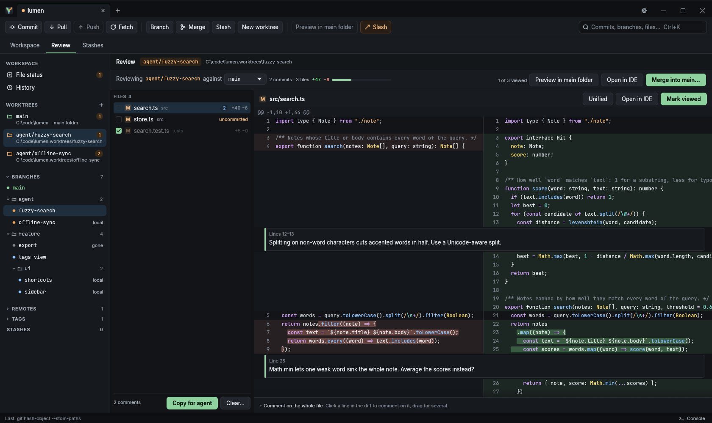
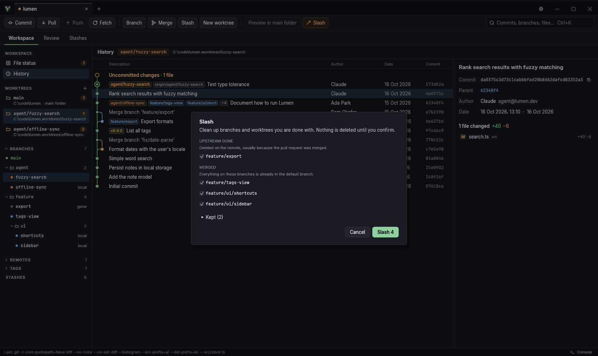
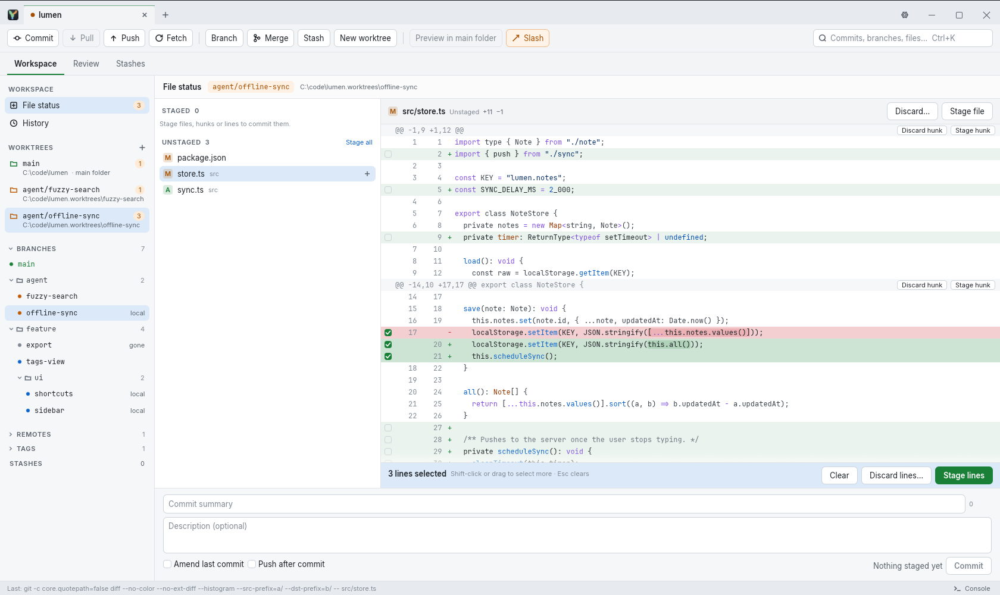

<p align="center">
  
</p>

<h1 align="center">Graft</h1>

<p align="center">
  <b>An opinionated git client for Windows.</b><br>
  Fast on big repositories, built around worktrees, and made for reviewing what your coding agents did.
</p>



## Why another git client?

If you run coding agents in parallel, you end up with a handful of worktrees: one branch each, some
commits, some uncommitted work, all at once. Most git clients treat worktrees as an afterthought and
leave review to the pull request page.

Graft starts from that workflow. Every worktree is in the sidebar with its changes. You review an
agent's work before it becomes a pull request, send your comments back to the agent, try the result in
your main folder, and clean up afterwards with one click.

## What Graft does differently

### Worktrees come first
- Every worktree sits in the sidebar with its branch, how many files changed and how far it is ahead.
- Changes show up live while an agent works.
- Create a worktree for a new or existing branch in one dialog. Ignored files your app needs, like
  `.env`, are copied over.

### Review before you merge
- See what a worktree would bring into main, **uncommitted changes included**, side by side or unified.
- Tick files off as **Viewed**. If a file changes after that, it comes back.
- **Comment on a line or a range** (click, Shift-click or drag), or on a whole file.
- **Copy for agent** puts every comment on the clipboard as Markdown, with the file, the lines and
  the code they refer to. Paste it into your coding agent's chat.
- Comments whose lines have changed since are marked outdated. Comments stay on your computer.

### Preview in main folder
Your dev server, database and IDE usually live in your main folder, not in the agent's worktree.
**Preview in main folder** checks out the agent's commits and uncommitted changes there, so you can run
them. **Restore main folder** puts it back the way it was.

### Slash: clean up in one go



Slash fetches, then lists what you are done with:
- branches whose upstream is gone (usually a merged pull request),
- branches already merged into the default branch,
- worktrees whose folder no longer exists.

Nothing is deleted until you confirm. Your current branch, the default branch, protected branches and
locked worktrees are never touched. Deleted branches can be restored from **Recently slashed**.

### Stage exactly what you mean



Stage or discard whole files, single hunks, or just the lines you tick. Then commit, amend, or
commit and push in one go.

### And also
- **Branches grouped by prefix:** `feature/foo` and `feature/bar` sit in a foldable `feature` folder.
- **Stashes remember their worktree.** Apply or pop a stash in a different worktree, or turn it into a branch.
- **Conflict resolver:** ours, base and theirs for each conflict, a live result, take-ours/take-theirs
  for whole files (lock files).
- **Syntax highlighting** in every diff, in a dark and a light theme (or match Windows).
- **The toolbar tells you why.** Buttons that can't do anything right now are greyed out, with the
  reason on hover. Labels use your repository's real default branch (`main`, `master`, `develop`…).
- **Git console:** every command Graft runs, with its output and how long it took.

## Fast
- The window never waits for git. All git work runs in the background, with Cancel for the long ones.
- History is read with [gitoxide](https://github.com/GitoxideLabs/gitoxide); long lists only draw the
  rows you can see.
- Diffs and syntax colors are worked out in the background. Big diffs show at once and get their
  colors a moment later.

## Opinions
- **Your git, your setup.** Graft runs your `git.exe` for everything that changes the repository, so
  hooks, config and Git Credential Manager keep working.
- **Nothing destructive without asking.** Discard, reset --hard, delete and Slash ask first.
- **Force push only as `--force-with-lease`.**
- **No accounts, no cloud, no telemetry.** Graft talks to your remotes through git and nowhere else.
- **Windows only.** It is a personal tool, tuned for one platform.

## Everyday git, of course
Open, clone or create repositories as tabs (they reopen on start) · commit graph with branch and tag
chips · checkout, create, rename, delete and track branches · cherry-pick, revert, reset ·
merge and rebase with Continue/Abort · tags · remotes · pull, push, fetch with progress · background
fetch · file history and blame · undo last commit · search everything with **Ctrl+K**.

## Install

You need [Git for Windows](https://git-scm.com/download/win).

From [Releases](https://github.com/mdi1984/graft/releases), either run `Graft-<version>-x64-setup.exe`
(installs for your user only, no admin rights) or unpack `Graft-<version>-x64.zip` anywhere you like
and start `graft.exe`. Graft checks for a new version when it starts and updates itself: click
**Update** in the title bar, or open **About** (click the Graft icon). An installed Graft updates
through the new setup, so Installed apps and winget show the right version. You can turn the check
off in Settings.

### Build from source

You need [Rust](https://rustup.rs). Then, in the repository folder:

```powershell
powershell -ExecutionPolicy Bypass -File tools\install.ps1
```

This builds Graft, installs it to `%LOCALAPPDATA%\Programs\Graft` and adds it to the Start menu. Run it
again to update.

<details>
<summary><b>Try it without installing</b></summary>

```powershell
cargo run --release
```

</details>

<details>
<summary><b>Keyboard shortcuts</b></summary>

The defaults below can all be changed in **Settings → Keyboard**. Tooltips show the current
shortcut for each action.

| Keys | Does |
| --- | --- |
| Ctrl+K | Search worktrees, branches, tags, commits and files |
| Ctrl+T | Open a repository (new tab) |
| Ctrl+O | Open a folder |
| Ctrl+W | Close the tab |
| Ctrl+Tab, Ctrl+Shift+Tab | Next / previous tab |
| Ctrl+, | Settings |
| F5 | Refresh |
| Ctrl+J | Show or hide the git console |
| ↑ / ↓ | Move through files, commits and search results |
| Space | Stage or unstage the selected file (File status) |
| Ctrl+S, Ctrl+Shift+S | Stage all / unstage all (File status) |
| Delete | Discard the selected file's changes, after asking (File status) |
| Ctrl+Enter | Commit (in File status), save (in a review comment) |
| V | Mark the file viewed (Review) |
| Esc | Clear the selected lines |

</details>

<details>
<summary><b>How it works</b></summary>

- Rust, with [egui](https://github.com/emilk/egui) for the interface.
- The interface thread only draws. Git work, diffs and highlighting run on background threads and
  report back.
- Reads: the history walk uses gitoxide. Status, refs, worktrees and diffs come from git's
  machine-readable output, so they always match what git itself says.
- Writes: `git.exe` for everything (commit, apply, push, pull, merge, rebase, stash, worktrees).
- A file watcher per worktree refreshes what changed.
- Diffs use the histogram algorithm with word-level highlights; syntax colors come from
  [syntect](https://github.com/trishume/syntect).
- Settings, review marks and comments are stored in `%APPDATA%\Graft`.

`CLAUDE.md` has the design notes.

</details>

## Contributing

Ideas and bug reports are very welcome as [issues](../../issues). Code contributions have a few
unusual rules (short version: no hand-written code); see [CONTRIBUTING.md](CONTRIBUTING.md).

## License

[MIT](LICENSE)
